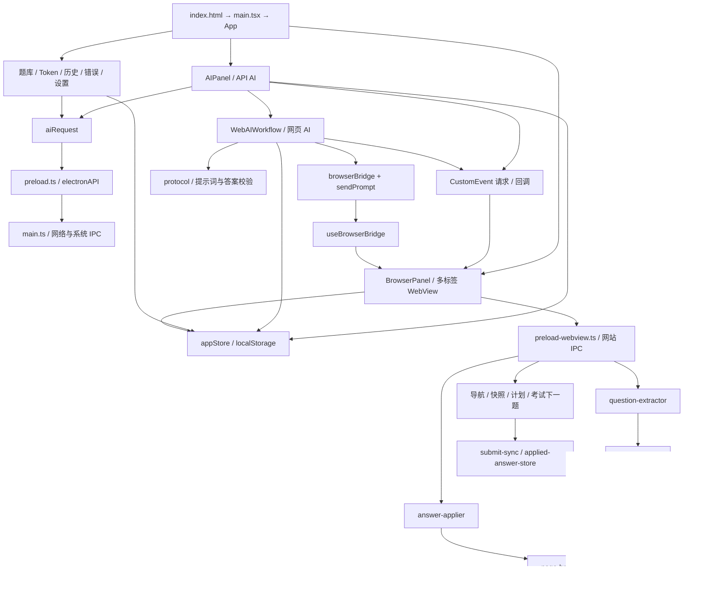

# 项目分析与变更边界

分析日期：2026-10-14。项目：study-pilot / 学习通答题辅助工具，package.json 版本 1.4.1。

本轮交付为分析、执行计划与独立 HTML 参考稿。没有实施章节删除、界面修改或提示词逻辑修改。

## 1. 分析结论

这是一个 Electron 桌面应用：React 工作台负责配置与答题流程，左侧 WebView 承载真实网站，WebView preload 负责抓题、定位、填入与页面同步，Electron 主进程提供网络、会话、窗口、日志及发布相关能力。API AI 与网页 AI 共用题目、答案、题库和填入能力，但获取答案的通道不同。

当前工作区已经存在一组章节删除改动，但尚未形成完整可构建闭环。后续应接续这些改动，清除剩余专用事件和构建复制步骤，而不能从文件名推断删除范围。字体解码仍依赖名称带 chapter 的桥接文件。

提示词总上限目前已是 **300000 字符**；真正限制每批题数的是独立的 50 题截取。需要将截取逻辑改为按完整提示词长度容纳整题，同时调整批次显示、超长题提示与对应测试。

界面应沿用当前最终生效样式：深色玻璃面板、靛紫主色、绿色网页 AI 状态色、左浏览器右工作台、最右竖向导航。美化范围限定在网页 AI 控件和浏览器答题进度条；教程作为新增展示模块接入右侧。

用户“不得修改其他功能块”的约束按以下范围执行：仅清理章节专用代码，以及实施本次明确授权的教程、网页 AI 按钮、答题进度视觉、提示词分批变更。共享文件中只动与这些要求直接相关的代码段，其他功能实现保持原样。

## 2. 阅读范围与工作区基线

当前 Git 跟踪 72 个路径，工作区存在 69 个文件、已删除 3 个文件。现存 src / electron 运行源码与样式共 39 个文件，测试 7 个文件；另审阅了 4 个脚本、4 个旧 HTML 设计稿、入口、构建配置、安装配置、CI 和说明文档。package-lock.json 按依赖锁定文件处理，不作为手写业务模块。已删除文件通过 Git 历史的接口、入口和职责辅助识别，不将其算作当前可运行源码。

开始分析时已有以下 11 个路径变更，均视为用户既有工作，后续不得重置、覆盖或重新恢复：

| 状态 | 路径 |
| --- | --- |
| 修改 | electron/main.ts |
| 修改 | electron/preload-webview.ts |
| 修改 | electron/preload-webview/chaoxing-chapter-api.ts |
| 删除 | electron/preload-webview/chaoxing-chapter-userscript.js |
| 删除 | electron/preload-webview/chapter-learning.ts |
| 修改 | electron/preload-webview/page-bridge.ts |
| 修改 | electron/preload-webview/types.ts |
| 修改 | src/App.tsx |
| 修改 | src/components/BrowserPanel.tsx |
| 删除 | src/components/ChapterLearningPanel.tsx |
| 修改 | src/store/appStore.ts |

已将这些路径的状态和所有现存跟踪文件的 SHA-256 记录在独立参考稿目录的 source-baseline.json、git-status-before.txt，供本轮无运行代码修改核验。未发现适用的 AGENTS.md。当前没有 node_modules；本轮没有安装依赖、运行应用、执行测试或构建。下文对构建问题的判断为静态分析结论，不冒充实际运行结果。

## 3. 功能与依赖结构

### 3.1 API AI 答题路径

获取页面题目 → appStore 保存 QuestionItem → 本地题库精确/上下文/兼容/模糊匹配 → 未命中调用 OpenAI 兼容 chat/completions → 答案规范化 → 保存题库、答案历史及 Token usage → 通过事件交给 BrowserPanel → 串行填入 WebView。

AIPanel 还支持只解析、批量解析、当前题填入、并发解析并填入、暂停/继续与逐题考试的下一题流程。并发默认 5，允许 1–5 路；429 使用退避，余额/额度不足中断后续调用。不能为了删除章节顺便改写这些路径。

### 3.2 网页 AI 答题路径

抓题与选择 → 生成带 requestId 和 q1…qn 的提示词 → 打开 DeepSeek / 豆包 / 千问 → 内置浏览器准备、确认发送，或外部浏览器手动复制发送 → 提取/粘贴 JSON → 校验请求 ID、题目 ID、答案格式、选项一致性和置信度 → 用户确认入库 → 回到原题页重新抓题比对 → 用户批准填入。

浏览器适配与发送确认分离：browserBridge 负责网页识别和操作，sendPrompt 负责确认是否已发送、识别手动发送和避免重复点击。分批变更不需要改动这两者。

当前下一批入口要求本批答案已完整导入；这是现有防止遗漏答案的流程，计划保留。长提示词也可能超过各网站自身输入或模型上下文限制，300000 只是本应用上限，教程不能承诺网站必然接收或完整作答。

### 3.3 抓题、字体解码和填入

question-extractor 优先识别题目容器及考试当前题，读取题型、题干、选项、定位信息，支持阅读上下文、完形以及填空恢复，并过滤页面脚本噪声。字体映射异步加载后用于替换私用码位字符。

answer-applier 根据题型、qid、选项字母、内容与 selector 定位，区分单选/多选/判断；填空支持多个输入、富文本及同源编辑器 iframe，保留 ## 分隔和段落结构，写入后校验。page-bridge 使隔离世界能够调用页面保存答案钩子。submit-sync 在保存/提交前同步页面字段，不能当成章节学习相关内容移除。

现有抓题器本身有噪声/题干长度等过滤规则。按字符分批只作用于已抓取并选中的题目，不扩大本次范围去修改抓题过滤器。

### 3.4 状态和持久化

全局状态由自制 GlobalStore 结合 useSyncExternalStore 管理，并未使用 Zustand。业务数据主要保存在渲染进程 localStorage；主进程 studypilot_db.json 另承接设置等 IPC 数据。网站登录态独立存于 persist:studypilot-sites 会话分区。

| 数据 | 位置 / 保留策略 |
| --- | --- |
| 设置、服务商、主题、并发 | studypilot_settings_v3，兼容 v2 |
| 本地题库 | studypilot_question_bank_v1，写入/导入保留最多 1000 条 |
| 答案历史 | studypilot_answer_history，最多 120 条 |
| 自动化历史 | studypilot_automation_history，最多 50 条 |
| Token usage | studypilot_token_usage_v1，最多 2000 条 |
| 浏览器标签/活动页 | 浏览器会话 localStorage，恢复最多 8 个标签 |
| 网页 AI 草稿 | studypilot-web-ai-pending-v1，保存当前 batch，未持久化完整剩余队列 |
| 网页 AI 打开请求/服务商 | 工作流专用 localStorage key |
| 真实网站 Cookie、网站存储 | Electron 持久化会话，不属于题库数据 |

移除章节不应清空这些存储，不做全库迁移、登录态重置或无关设置清理。

## 4. 逐文件职责清单

以下路径均相对于仓库根目录。

### 4.1 Electron 主进程与入口（5 个）

| 文件 | 实现内容与模块职责 | 主要依赖 / 保护点 |
| --- | --- | --- |
| electron/main.ts | 窗口与标题栏、配置文件、HTTP/S 和编码处理、AI 代理/流式响应、模型发现、更新、云题库、会话持久化、截图、诊断、新窗口与 frame 导航处理 | Electron、Node、iconv-lite；现有章节 IPC 删除之外不扩大改动 |
| electron/preload.ts | 用 contextBridge 暴露 electronAPI，封装 IPC 请求、事件订阅与 renderer 错误上报 | main 的公共 IPC 合同；保留 API、会话、云题库等接口 |
| electron/preload-webview.ts | 网站 preload 入口；安装桥接、字体映射、导航补丁，注册抓题、填入、快照、计划、下一题等 IPC | preload-webview 子模块；章节入口已有删除 |
| electron/error-logger.ts | 序列化错误、写本地诊断文件、读取近期错误，处理日志文件生命周期 | 主进程文件系统；与章节无专属关系 |
| electron/inject.ts | 兼容旧布局的注入脚本占位 | 当前真实 WebView 能力由 preload 承接；本轮保留 |

### 4.2 网站预加载子模块（15 个）

| 文件 | 实现内容与模块职责 | 主要依赖 / 保护点 |
| --- | --- | --- |
| answer-applier.ts | 解析目标选项；按 qid/selector/字母/文本匹配并点击；选择值同步；填空与富文本写入及结果校验 | extractor、matcher、dom-utils、interaction、page-bridge、applied-answer-store；全部保留 |
| answer-matcher.ts | 字符相似度、答案别名、判断语义与否定语义解析，避免“错误/不正确”等误判 | DOM/文本基础；API 和填入共用 |
| applied-answer-store.ts | 记忆已填 qid 对应答案和标签，供后续校验与保存同步 | answer-applier、submit-sync 共用 |
| bridge.ts | WebView 异常序列化、全局异常监听与 sendToHost 诊断上报 | Electron ipcRenderer |
| chaoxing-chapter-api.ts | 当前只保留 safeJsonParse 与 readTtfList：调用页面桥获取字体映射 | **保留文件与文件名**；font-decode 直接引用 |
| dom-utils.ts | 唯一 selector、可见性、清理脚本噪声、乱码修复、文本归一化、hash、选项文本、事件与去重 | 抓题、填入、导航、快照等基础依赖 |
| exam-flow.ts | 查找并点击考试下一题，识别可见按钮与页面状态 | DOM 与点击工具；不能因“章节测验”名称联想删除 |
| font-decode.ts | 加载并缓存字体映射，替换 PUA 字符，提供同步文本解码 | readTtfList → page-bridge |
| interaction.ts | 派发用户点击事件序列 | 多个自动化模块共用 |
| navigation.ts | 拦截新窗并转内置标签，修复课程/考试 URL；保存前同步、防重复保存、页面请求与提示诊断 | bridge、dom-utils、submit-sync 回调；通用网站兼容层 |
| page-bridge.ts | 在页面主世界安装受限操作桥，以请求 ID 和事件响应同步选择/判断/填空，以及获取字体映射 | syncChoice、syncJudgement、syncCompletion、cxReadTtfList 都保留 |
| question-extractor.ts | DOM 和文本兜底抓题、选项排序、题型判定、阅读/完形上下文、填空恢复、字体解码 | matcher、dom-utils、font-decode |
| snapshot.ts | 抽取可见可交互元素的页面快照、标识和标签，供生成自动化计划 | dom-utils |
| submit-sync.ts | 保存/提交前使可见选项、隐藏字段和记忆答案一致 | applied-answer-store、matcher、extractor；保留 |
| types.ts | WebView 自动化、题目、选项目标、答案填入的类型合同 | 章节类型已有删除；共享类型保留 |

### 4.3 React 入口、状态与通道（5 个）

| 文件 | 实现内容与模块职责 | 主要依赖 / 保护点 |
| --- | --- | --- |
| src/main.tsx | 挂载 React 根节点并加载全局样式 | App、ReactDOM |
| src/App.tsx | 总布局、主题、右栏宽度与收起、导航切换、状态日志、启动公告、窗口操作、全局 jelly 交互 | 组件、appStore、lucide-react；教程只新增导航和渲染分支 |
| src/index.css | 全局设计变量、玻璃组件、主题、题库界面、浏览器与答题进度样式、最后覆盖的桌面布局 | CSS 多轮叠加；只改 browser-solving-dock 专用选择器 |
| src/store/appStore.ts | 类型与服务商预设、设置与历史持久化、题库归一化/去重/匹配、答案状态、计划状态、日志和 Token 统计 | 自制订阅 store；章节已删部分不再改写其他业务 |
| src/utils/aiRequest.ts | API 非流式/流式请求；优先主进程代理，纯浏览器环境 fallback fetch；超时与回调清理 | electronAPI / fetch；网页 AI 提示词改动无需触碰 |

### 4.4 React 业务组件（8 个）

| 文件 | 实现内容与模块职责 | 主要依赖 / 保护点 |
| --- | --- | --- |
| AIPanel.tsx | API / 网页 AI 模式入口，题库优先查询、调用重试、并发任务、逐题考试、暂停继续、填入调度与答案列表 | appStore、aiRequest、WebAIWorkflow；仅删章节专用 answer-all-and-apply 监听 |
| BrowserPanel.tsx | 多标签 WebView、地址与导航、登录会话、演示页、IPC/CustomEvent 桥、快照计划、填入队列、答题进度 | appStore、useBrowserBridge；仅删章节残留帮助函数/监听，进度逻辑保留 |
| KnowledgeBase.tsx | 题库筛选/统计、JSON 导入导出、手动格式解析与加入、网页 AI 导入入口、题目与答案显示 | appStore、openWebAI；不改其 UI/匹配/解析逻辑 |
| SettingsPanel.tsx | 服务商/URL/模型与 Key、拉取模型、测试聊天、更新、真实 WebView 开关、登录态清理、主题 | aiRequest、electronAPI；现有 Key 教程仅局部说明，不代替新增教程页 |
| TokenUsagePanel.tsx | usage 总览、热力图、模型排行、明细筛选排序、清空统计 | appStore；保持完整 |
| HistoryPanel.tsx | 运行记录检索和展示、详情、清空 | appStore；保持完整 |
| BugReportPanel.tsx | 错误日志加载/刷新、筛选、路径、错误详情与相关跳转 | appStore、electronAPI；保持完整 |
| AnnouncementBanner.tsx | 顶部可展开/关闭的操作说明横幅 | 独立 UI 状态；新增教程不替换公告 |

### 4.5 网页 AI（6 个）

| 文件 | 实现内容与模块职责 | 本次可改范围 |
| --- | --- | --- |
| WebAIWorkflow.tsx | 内嵌/弹窗工作流、题目选择、批次、草稿恢复、开站、发送、提取、预览、确认入库、批准填入、停止 | 按字符生成/剩余/跳过显示；去 learning 状态残留；按钮样式类 |
| protocol.ts | 服务商列表、batch 创建、提示词模板、总长校验、JSON 回答校验、q ID 与原题映射、原页面一致性比较 | prepareWebBatch 与精确长度辅助；保留答案校验、模板语义和映射 |
| browserBridge.ts | 浏览器事件合同与命令；三个网站的就绪/忙碌/输入/发送/回复识别及页面操作 | 不改 |
| useBrowserBridge.ts | 将命令连接到 BrowserPanel 的 WebView 集合、活动页与新标签能力，检查源站/目标页 | 不改 |
| sendPrompt.ts | 准备后的发送确认、取消检查、手动发送识别与防止重复发送 | 不改 |
| web-ai.css | 内嵌/弹窗/浮动任务条、步骤、按钮、选择器、预览样式 | 仅网页 AI 作用域的按钮和必要视觉状态 |

### 4.6 测试（7 个）

| 文件 | 当前验证内容 | 计划处理 |
| --- | --- | --- |
| tests/answer-matcher.test.ts | 判断语义、否定词与选项值 | 保留并运行 |
| tests/dom-utils.test.ts | 选项前缀、首字母与小数题号边界 | 保留并运行 |
| tests/question-extractor.test.ts | 题型元信息/资料题与脚本噪声区分 | 保留并运行 |
| tests/appstore.test.ts | 多选、同题干不同选项、乱序选项映射、上下文/演示答案隔离等题库行为 | 保留并运行 |
| tests/web-ai.test.ts | 请求 ID、答案字段/字母正文/置信度、原题匹配、50 题分批、提示词边界 | 只替换固定题数断言并增加字符分批行为测试 |
| tests/web-ai-protocol.test.ts | 填空 ## 分隔、缩进、结构与直接填入内容 | 保留并运行 |
| tests/web-ai-send.test.ts | 发送确认、手动发送、取消与避免重复发送 | 保留并运行，不随分批重写 |

### 4.7 脚本、配置、文档与静态稿

| 文件 | 用途 / 实现 |
| --- | --- |
| scripts/build-webview-preload.mjs | esbuild 将网站 preload 打成单 CJS，electron 外置；当前仍复制已删章节 userscript，必须清理专用复制步骤 |
| scripts/verify-webview-preload-bundle.mjs | 检查 app.asar 中的 preload 是否仍有相对 split-module require，防止沙箱运行缺模块 |
| scripts/build-win-release.ps1 | Windows 发布构建、清理旧 release、验证安装包资源与 preload；执行阶段验证，不顺手重写 |
| scripts/collect-error-logs.ps1 | 收集本地日志与诊断材料 |
| .github/workflows/release.yml | 标签/手动触发 Windows CI，Node 20 + npm ci，打包并上传 Release；本轮不发布 |
| build/installer.nsh | NSIS 安装/卸载定制与应用数据清理；保留升级和卸载行为 |
| package.json | 命令、运行/开发依赖、electron-builder/asar/NSIS 配置；本次默认不动依赖 |
| package-lock.json | 锁定 npm 依赖树；不因删章节顺带重算依赖 |
| tsconfig.json | renderer 严格 TS、React JSX、bundler 解析、@ 别名、noEmit |
| tsconfig.electron.json | Electron CommonJS 输出到 dist-electron，独立严格编译 |
| vite.config.ts | React 构建与开发入口、输出配置 |
| vitest.config.ts | node 测试环境、tests/**/*.test.ts、@ 路径别名 |
| index.html | React 容器、页面元数据、现有字体资源及 main.tsx 入口 |
| .gitignore | 依赖、产物、日志、环境数据等排除规则 |
| README.md | 产品、配置、运行、题库、发布说明；现行章节功能/指南过时，应定点更新 |
| docs/releases/v1.2.2.md | 历史版本说明，保留 |
| docs/releases/v1.3.1.md | 历史版本说明，保留 |
| docs/releases/v1.4.0.md | 历史版本说明，保留 |
| docs/releases/v1.4.1.md | 历史版本说明，保留 |
| design-proposals/index.html | 旧三方案索引，静态选择稿，无运行依赖 |
| design-proposals/a-sidebar-cards.html | 旧深色左侧导航工作台，无应用事件逻辑 |
| design-proposals/b-top-tabs.html | 旧浅色顶栏工作台，无应用事件逻辑 |
| design-proposals/c-immersive-glass.html | 旧分屏玻璃工作台，无应用事件逻辑 |

旧设计稿不是当前 UI 的权威来源：它们包含旧章节/云题库入口，颜色及布局也与当前最终 CSS 不同。新增参考稿以当前应用源码为准，不覆盖旧稿。

### 4.8 已从工作区删除的章节专用文件

| 文件 | 历史职责 | 后续处理 |
| --- | --- | --- |
| src/components/ChapterLearningPanel.tsx | 章节设置、任务展示、开始/停止操作入口 | 保持删除，不恢复 |
| electron/preload-webview/chapter-learning.ts | 跨 frame 媒体/文档/任务点、章节跳转与章节测验调度 | 保持删除，清除存活调用者 |
| electron/preload-webview/chaoxing-chapter-userscript.js | 章节学习 userscript 与媒体/任务运行时 | 保持删除，删除打包复制引用 |

## 5. 章节移除的依赖证据与残留

| 证据位置（当前行号） | 发现 | 执行计划 |
| --- | --- | --- |
| scripts/build-webview-preload.mjs:24 | copyFile 的源 userscript 已不存在 | 删除该复制语句、copyFile import 和仅供它使用的子目录 mkdir；保留主 bundle |
| BrowserPanel.tsx:1005 | 监听 chapter-learning-action，向 WebView 发 chapter-learning | 整段专用 useEffect 移除，保留一般抓题/填入/导航监听 |
| BrowserPanel.tsx:1015 | setStatus('learning', …)，AutomationStatus 已无 learning | 随上述专用段删除；静态可见 TS 不兼容，尚未跑 tsc |
| BrowserPanel.tsx:260 / 271 / 284 | comparableNavigationUrl、chapterNavigationIdentity、isSameChapterNavigation 只在章节专用辅助链内相互引用 | 按调用搜索证据删除整条无调用链 |
| AIPanel.tsx:713 | answer-all-and-apply 监听的生产者已随章节删除，当前仅见自身注册/注销 | 删除该专用 useEffect；保留通用 callAllAI、requestAIWithRetry、applyAnswersToPage |
| WebAIWorkflow.tsx:115 | 忙碌状态数组含 learning | 只移除这一元素 |
| SettingsPanel.tsx:309 | 注释提到章节开关 | 仅可定点更新注释，不改任何设置实现；也可保留注释避免无必要变更 |
| README.md:72 / 244 | 仍宣称支持章节学习并提供操作步骤 | 删除现行功能/使用指南，保留真实历史版本记录 |

构建脚本的问题会使复制步骤在运行到这里时报 ENOENT；但实际构建也可能先被其他错误阻断，因此不声称已实际重现。主进程、入口和类型已有章节删除，执行时只复核闭环，不重复改写。

**不能删除的链路：** question-extractor → font-decode → chaoxing-chapter-api.readTtfList → page-bridge.cxReadTtfList。保留原名可以避免为命名重构触碰本次保护的抓题模块。

当前未发现 blueimp-md5 的运行源码引用，但仅凭“没引用”不足以认定属于章节删除范围。本次默认保留 package.json / lockfile 中依赖，不做无关依赖清理。

## 6. 300000 字符规则与现状差异

当前 protocol.ts:12 定义 WEB_AI_BATCH_SIZE = 50；:13 定义 WEB_AI_PROMPT_LIMIT = 300000；prepareWebBatch 先 slice(0, 50)，然后生成提示词并验证。若整批超长，直接报错，没有自动按字符预算拆分，也没有整题跳过机制。WebAIWorkflow.tsx:151 按 ceil(题数/50) 算总批次，:336 仍显示每批最多 50 题。

确定采用以下规则：

1. 最终可复制/发送的完整提示词长度不超过 300000，恰好等于允许。沿用现有 JavaScript string.length 口径，即 UTF-16 code unit；不是字节数或 Token 数。中文通常记 1，部分 emoji 记 2。
2. 不限制题目数量；短题可以一批超过 50 题。
3. 按用户选择的原顺序容纳完整题目，计算题干、context、options、JSON 转义、题号、requestId、模板与空白的全部长度。
4. 一题使当前累计超限，但独立发送可容纳：不加入当前批，完整保留到下一批。
5. 一题连单题所需模板都超过 300000：仅从本次发送队列跳过这题；不截断、不删除抓题数据和本地题库；提示题号/原因，继续后题。
6. 全部超长或没有可发送题目：不给空提示词发送入口，显示明确结果，并使剩余队列终止，不能死循环。
7. 每批独立 requestId，批内 q1…qn 连续，答案仍按 batch.questions 映射回原 hash；发送、复制前保持现有长度校验。

显示采用“第 N 批 · 本批 X 题 · 待处理 Y 题 · 跳过 Z 题”，避免继续使用错误的题数除法估算。网页 AI 站点若截断回答，仍使用现有缺题校验，不能绕过完整导入要求。

## 7. UI 基准与设计方向

权威样式是 src/index.css 最后覆盖段（1942 起），不能只参考文件开头的旧变量。

| 元素 | 当前基准 | 参考稿 / 实施约束 |
| --- | --- | --- |
| 深色背景/面板 | #05070d；rgba(15,21,37,.75) / #0f1525 | 保留玻璃层次，不换青蓝后台或全白布局 |
| 主色/强调色 | #6366f1 / #a855f7 | 主操作靛紫，绿色用于网页 AI 和完成状态 |
| 文本 | #f8fafc / #94a3b8 / #64748b | 保留层级；正文和禁用文字仍可读 |
| 浅色 | #f1f4fa / 白色面板；#4f46e5 / #7c3aed | 同时验证浅色主题 |
| 圆角 | 面板 15，按钮 10，最右导航 15 | 沿用现有尺度 |
| 布局 | 左浏览器、可调右面板、70px 竖向导航 | 教程在右侧新增入口，不移动其他模块 |
| 图标/字体 | lucide-react；Outfit / Noto Sans SC 与系统 fallback | 参考稿离线 SVG、系统字体，不引入新 UI 库 |

参考稿提供 A“克制玻璃”（推荐）与 B“柔光强化”：两者保留同一配色与结构，只比较主按钮层次、边缘高光、流光亮度/节奏。深浅主题、教程和答题面板、进度运行/完成/错误/空闲与减少动效可切换。浏览器区域是虚构题目的示意，不连接网站、不代表已实施。

教程内容覆盖：准备与登录、网页 AI 六步、外部手动发送、300000 规则、API 配置/测试/并发/题库优先、本地题库导入导出与手工格式、进度与常见问题、日志与 Token 的含义。教程通过目录定位与折叠章节浏览，不新增自动化业务。外部模式只完成手动发送与入库，第六步直接回原页填入只在内置模式提供。

进度美化限定 browser-solving-dock。BrowserPanel.tsx:522 的解析/填入加权进度和 :554 的完成后 720ms 隐藏保持原样。running 使用单条低对比流光；完成/错误/空闲停动画，配合文字与图标；prefers-reduced-motion 静态显示。题库自己的 kb-progress 不在本次美化范围。

全局 jelly 运行时可能为 transform 写入 !important；进度胶囊当前用 translateX(-50%) 居中，实施时需验证不受已有交互影响。优先在进度内部装饰层做效果，不改全局 jelly 或所有按钮。

## 8. 验证结论及限制

可以依据调用链划定安全删除边界，但在实际删改、构建与 WebView 回归之前，不能声称“移除后已确认完全无影响”。执行计划将该要求转化为三层验收：保护文件哈希/局部 diff、全部现有测试与新增分批边界测试、真实 WebView 关键流程冒烟及安装包 preload 校验。

本轮仅完成静态阅读与分析，未运行项目测试、构建或真实网站操作。发现的其他潜在重构点、无入口后端能力、历史兼容代码和无关问题都不作为本次修改理由。

独立 HTML 参考稿已生成，内联 JavaScript 语法检查通过。浏览器检查连接器遇到审批服务 503；原生浏览器启动受 EPERM 限制，内置浏览器又明确禁止 file:// URL，因此未完成实际渲染、交互及截图验证，未通过其他浏览器路径绕过该限制。使用者可在自己的浏览器中手动打开 HTML 选择方向。

配套执行计划：docs/superpowers/plans/2026-10-14-chapter-removal-web-ai-ui.md。
