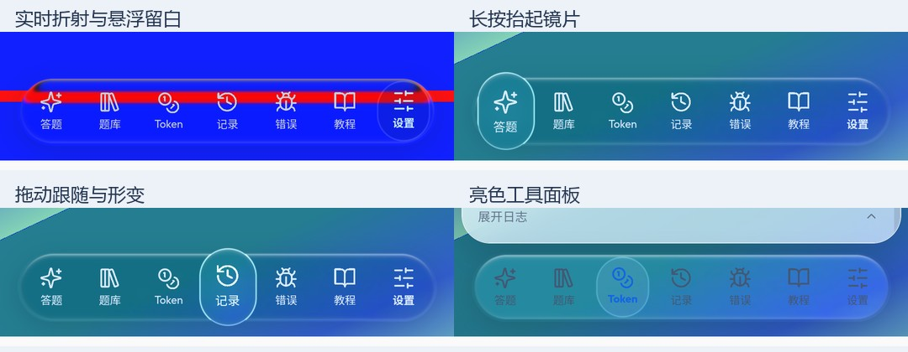
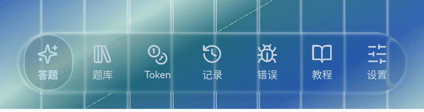

# Android v1.4.1 验证记录

验证日期：2026-11-18。包名 `com.studypilot.android`，版本 `1.4.1` / versionCode `6`，minSdk 24、targetSdk 36。Android 17 按要求跳过。

## 构建产物

- APK：`release/android/Xuexitong-Answer-Helper-android-v1.4.1.apk`，5,209,033 字节。
- SHA256：`f9c00f36e2fdeecc31cde78b1b0191ca72687126fdb65198edc6df8dac5952ba`。
- Android Debug 签名；证书 SHA256：`8df3552ae21550b600311e2ed01bb89d99234ca92428cb3435cc893b57bc9f22`。
- `npm test`：24 个文件、412 项测试通过。
- `npm run android:build`：TypeScript、网页、原生桥及 APK 构建通过。
- `android/gradlew.bat -p android :app:lintDebug`：0 errors、30 warnings，包含既有弃用 API、KTX 与资源加载建议。
- `git diff --check` 与检查脚本语法检查通过。

## 设备记录

使用同一个 APK、真实 ADB 触摸、系统输入法和调试 WebView。本地夹具提供题目和 AI 回复，不使用真实账号或提交作业。

| 系统 | WebView | 自动检查 |
| --- | --- | --- |
| Android 15 / API 35 | 124.0.6367.219 | [底栏](floating-glass-v141-api35/glass-results.json)、[点按轨迹](floating-glass-v141-api35/tap-motion.json)、[浏览器](floating-glass-v141-api35/results.json)、[后台状态](floating-glass-v141-api35/task-status-results.json) |
| Android 16 / API 36 | 133.0.6943.137 | [底栏](floating-glass-v141-api36/glass-results.json)、[点按轨迹](floating-glass-v141-api36/tap-motion.json)、[浏览器](floating-glass-v141-api36/results.json)、[后台状态](floating-glass-v141-api36/task-status-results.json) |

各 JSON 的 `checkedAt` 为 UTC 时间，以成功运行的最终结果为准。

## 本轮重点

- 先在旧安装包复现：原生网页在 Tab 上方结束，完整视口断言失败。修复后，网页延伸至安全区域底部，悬浮栏左右及下方保留空隙，横屏居中限宽。
- 使用固定位置的窄红色标记与蓝色背景读取 GPU 像素，确认玻璃采样保持实际屏幕位置；单色切换确认不按按钮也持续刷新，工具展开后不采入工具自身。
- 先复现长页面滚动后纹理仍显示旧位置；修复后，滚动超过一个视口，玻璃显示当前可见色块。记录真实点按的逐帧镜片位置，要求经过多个中间位置、迅速到达目标且不覆盖相邻按钮。
- 长按镜片高度超过底板，图标及文字由同一移动区域裁剪、放大与边缘位移；拖动的最终横向范围始终留在栏内。手指向上离开底栏后松开仍提交水平选中目标。
- 位移场单测确认中心不偏移、相对边缘向相反方向折射；镜片尺寸单测确认长按能抬出底板且保持水平中心及边界。
- 同一 Tab 再次点击收起，外部点击只收起并消费整个手势。面板关闭后，栏侧与底部间隙的真实点击可到达网页；面板打开时，同样位置只关闭面板。
- 横竖屏外部拖动、长按及跨关闭动画的手势不泄漏。快速反转开闭、草稿保留、弹窗优先、减少动态效果及 GPU 丢失后回退与恢复通过。
- 七工具页主要控件在明暗主题下保留玻璃材质；320px 窄屏保持常态 44px 触摸目标，短划滚动、长按边缘自动滚动。
- 真实账号/密码输入、IME 安全区及恢复、长提示词与三图一次发送、标签历史、原题填回、双层跨域 iframe 与过期答案拒绝通过。
- 后台自动答题、系统进度通知、可选媒体卡片暂停/继续、任务结束释放服务、无任务冷启动及通知权限检测回归通过。

## 验证范围

截图与实际拖动在模拟器复核。触觉调用尊重系统设置，实体设备震感未实测。AOSP 模拟器不代表厂商系统的上岛资格或私有动画；本轮保持公开通知及媒体接口。

玻璃采样限制大小且串行执行，后台停止；部分硬件视频或 WebGL 内容可能不包含在软件采样中。横屏键盘打开时为输入保留工具区域，键盘关闭后恢复悬浮栏下方的完整网页。

动图使用固定帧间隔展示交互形态；实际点按的位置与时间见上述轨迹 JSON。
