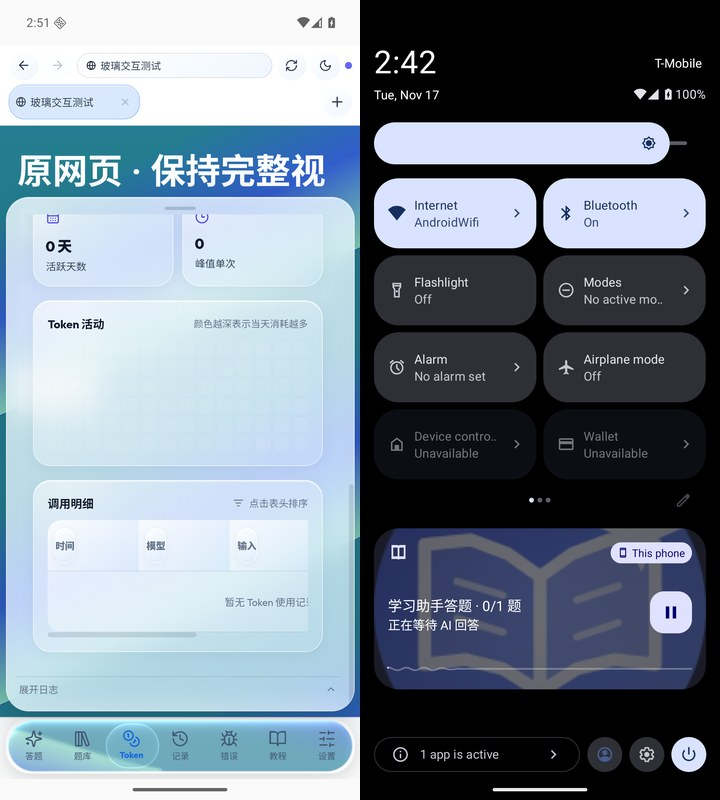

# Android v1.4.0 验证记录

验证日期：2026-11-17。版本 `1.4.0` / versionCode `5`，本轮完成 Android 15–16 验证；用户明确跳过 Android 17。

## 安装包与自动检查

- APK：`release/android/Xuexitong-Answer-Helper-android-v1.4.0.apk`，使用 Android Debug 签名。
- SHA256：`9cb2827af5f32d3d4293729d1084d3f32f23db28017939a0f29cb2d1b98d9413`。
- 签名证书 SHA256：`8df3552ae21550b600311e2ed01bb89d99234ca92428cb3435cc893b57bc9f22`。
- `npm test`：24 个文件、404 项测试通过，包括持续采样的无重叠、隐藏停止、恢复和最终镜片边界。
- `npm run android:build`：TypeScript、网页、Kotlin 与 APK 构建通过。
- `android/gradlew.bat -p android :app:lintDebug`：0 errors、30 warnings，包含既有弃用 API、KTX 与资源加载建议。
- 三个 Android 检查脚本的语法检查和差异空白检查通过。

## 模拟器记录

使用同一 APK、真实 ADB 触摸、系统键盘与调试 WebView。题目和 AI 回复均使用本地夹具，不连接真实账号或提交作业。

| 系统 | WebView | 记录 |
| --- | --- | --- |
| Android 15 / API 35 | 124.0.6367.219 | [底栏](live-glass-v140-api35/glass-results.json)、[浏览器](live-glass-v140-api35/results.json)、[权限](live-glass-v140-api35/task-status-results.json) |
| Android 16 / API 36 | 133.0.6943.137 | [底栏](live-glass-v140-api36/glass-results.json)、[浏览器](live-glass-v140-api36/results.json)、[权限](live-glass-v140-api36/task-status-results.json) |
| Android 17 / API 37 | 用户要求跳过 | 未计为通过 |

各 JSON 的 `checkedAt` 为 UTC 时间，以脚本最后成功结果为准。

## 已覆盖行为

- 源网页自行红蓝变色时，无点击、导航或调整尺寸，读取 GPU 像素确认折射随之变化；展开工具后纹理不采入工具自身。
- 最终拉伸后的镜片保持在底栏内；亮暗主题 GPU 模式不额外绘制 CSS 选中层。丢失图形上下文时降级，再恢复 GPU。
- 七个工具页主要卡片、按钮、输入与选项的渐变玻璃和圆角；稳定截图等待颗粒动画真正结束。
- 长按拖动、按压抬升、图标放大、窄屏边缘滚动、快速切换、同 Tab 再次点击收起、草稿保留、减少动态效果与弹窗优先。
- 外侧点击、拖动、长按及跨越关闭动画的整段手势不泄漏到网页；下次点击可进入网页。面板开闭不压缩网页。
- 横竖屏真实输入、键盘安全区、长提示词与三图发送一次、原题标签保留、新窗口与历史、双层跨域 iframe 提取填回及过期答案拒绝。
- 经界面启动自动答题，切至其他应用后验证系统进度通知，无应用浮条。Android 16 起检查实际通知模板为 ProgressStyle。
- 主动开启媒体模式后，系统媒体区实际显示题数、任务阶段、波形进度和暂停按钮；系统对指定媒体会话发送暂停/继续命令，真实自动任务回传状态。速度为零，进度不会随等待时间虚增。
- 关闭媒体模式立即释放会话；重新启用后保留至任务完成，验证后台填答后服务与媒体会话均结束。回到前台核对答案已填入，任务入口打开答题工具。
- 无任务时开启媒体模式不创建会话或服务；旧悬浮条调用不再创建窗口。通知拒绝可检测，原生实时状态设置可打开，冷启动不恢复旧任务。

## 厂商公开接口核对

| 品牌 | 厂商专用状态接口 | 本包当前接入 |
| --- | --- | --- |
| 小米、红米 | 超级岛客户端通知模板需平台准入与包名权限 | Android 标准进度通知，可选媒体卡片 |
| OPPO、一加、realme | 流体云本地接入需场景、服务信息与平台接入确认 | Android 标准进度通知，可选媒体卡片 |
| vivo、iQOO | 原子通知及超级岛模板需平台授权与场景准入 | Android 标准进度通知，可选媒体卡片 |

用户确认尚未开通厂商权限。本包不写入未经准入核验的私有参数，标准媒体会话供系统自行识别；不创建假音轨、不获取音频焦点、不用时间冒充完成量。媒体模式可能占用音乐控制区，未抢占全局耳机按键。

公开文档：[Android 实时进度](https://developer.android.com/about/versions/16/features/progress-centric-notifications)、[Android 媒体界面](https://developer.android.com/media/implement/surfaces/mobile)、[小米客户端接入](https://dev.mi.com/xiaomihyperos/documentation/detail?pId=2131)、[OPPO 接入](https://open.oppomobile.com/documentation/page/info?id=13558)、[vivo 接入](https://dev.vivo.com.cn/documentCenter/doc/894)。

## 验证边界

Android 17 镜像在应用安装前出现 SurfaceFlinger 的 `hasReadColorBufferDma` 断言崩溃。尝试稳定与预览版模拟器、不同图形后端及扩容测试分区后仍未得到可用环境，用户要求跳过，已停止测试设备；未将其计为应用测试通过。

AOSP 模拟器验证标准卡片与通知行为，不能证明七个品牌实体设备的上岛资格、胶囊点击展开、高光动画或系统省电行为。系统决定是否上岛以及具体外观；未宣称已取得厂商专用权限。Android 16 模拟器未授予 promoted notifications，已验证 ProgressStyle 通知与可选媒体界面。

持续采样限制大小且串行执行，后台停止。源 WebView 的软件绘制可能不包含部分硬件视频或 WebGL 内容。强制停止、清理进程、系统回收及断网仍可能中断任务，应用不自动重启旧任务。本轮未新增密码框专用处理，保留已有登录回归。

