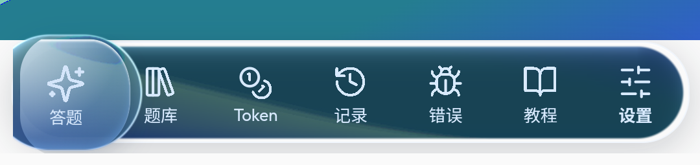

# Android v1.3.0 验证记录

验证日期：2026-11-17。版本 `1.3.0` / versionCode `4`，最低 API 24。

## 安装包

- 文件：`release/android/Xuexitong-Answer-Helper-android-v1.3.0.apk`，5,202,577 字节。
- SHA256：`ecf1f2bf23a91cf3b76a4122342d8f8ad481c352da7bcae20a9e393dac2e3d4e`。
- Android Debug 签名，证书 SHA256：`8df3552ae21550b600311e2ed01bb89d99234ca92428cb3435cc893b57bc9f22`。

## 自动检查

- `npm test`：23 个文件、395 项测试通过。
- `npm run android:build`：TypeScript、网页构建和 Android Debug APK 构建通过。
- `android/gradlew.bat -p android :app:lintDebug --console=plain`：0 errors、28 warnings。提示包含既有弃用 API 和 KTX 风格建议。
- 三个安卓检查脚本的 `node --check` 及 `git diff --check` 通过。
- README 与 docs 下 Markdown 不含其他仓库的参照名称或链接。

## 设备记录

模拟器安装上述同一签名 APK，使用 ADB 实际触摸、系统输入法和可调试 WebView。题目和 AI 回复使用本地夹具，不使用真实账号，也不提交作业。

| 系统 | WebView | 玻璃路径 | 结果文件 |
| --- | --- | --- | --- |
| Android 10 / API 29 | 124.0.6367.219 | CSS 兼容玻璃 | [底栏](ultra-glass-v130-api29/glass-results.json)、[权限](ultra-glass-v130-api29/task-status-results.json)、[浏览器](ultra-glass-v130-api29/results.json) |
| Android 15 / API 35 | 124.0.6367.219 | GPU 折射 | [底栏](ultra-glass-v130-api35/glass-results.json)、[权限](ultra-glass-v130-api35/task-status-results.json)、[浏览器](ultra-glass-v130-api35/results.json) |
| Android 16 / API 36 | 133.0.6943.137 | GPU 折射 | [底栏](ultra-glass-v130-api36/glass-results.json)、[权限](ultra-glass-v130-api36/task-status-results.json)、[浏览器](ultra-glass-v130-api36/results.json) |

各 JSON 的 `checkedAt` 是 UTC 时间，以对应脚本最后一次成功输出为准。

三套系统的底栏、权限和浏览器检查脚本均通过；Android 16 最后一次浏览器检查完成于 `2026-11-17T12:55:31Z`。

## 覆盖行为

- 七个 Tab、长按拖动、镜片抬升、图标放大、弹簧跟随、快速切换、窄屏短划滚动和长拖边缘滚动。同一 Tab 再次点击收起，工具草稿保留。
- 面板切换及收起时颗粒消散；面板外点击、长按和跨越关闭动画的完整手势均被消费，下一次点击正常进入网页，浏览器尺寸不变。
- 深浅主题、320 CSS 像素宽度、1.3 倍系统字号、减少动态效果及弹窗优先级。
- 新系统读取实际 GPU 像素，并主动丢失图形上下文验证 CSS 降级；旧系统不创建 WebGL 叠层，保留镜片和交互动画。
- 横竖屏使用实际按键输入；键盘打开后安全区只扣除一次。长提示词及三张图片通过图标按钮发送一次，草稿经过旋转仍保留。
- 新窗口独立标签、前进后退、切回原题填回，以及双层跨域 iframe 提取、填回和子页跳转后的过期答案拒绝。
- 通过界面启动真实自动答题，等待新建 AI 标签发送成功后切到其他应用。延迟 45 秒回复，验证后台接收、填回、持续通知和顶部胶囊。
- 在可旋转的系统页面核对截图方向，验证胶囊横竖屏布局；关闭胶囊时任务继续；完成后前台服务和窗口移除，唤醒锁在服务销毁时释放。任务返回 Intent 打开答题工具。
- 空闲应用不显示旧任务；通知关闭可检测，胶囊由用户选择开启；冷启动任务入口不会重新运行历史任务。

## 兼容处理和限制

- Android 10 模拟器复现了双 WebView 上叠加 WebGL 后的硬件绘制线程停滞。Android 7–10 使用 CSS 材质，Android 11 起启用 GPU 折射；图形能力失败时保留交互。背景采样使用异步 PixelCopy，不同步调用 WebView.draw。
- 顶部胶囊由用户在“设置 → 真实页面能力 → 后台答题状态”开启，并授予显示在其他应用上层权限。它仅在任务运行且应用处于后台时显示，不抢输入焦点，不展示题目、账号、答案或提示词正文。
- Android 16 请求通知实时提升；该模拟器 `canPostPromotedNotifications` 为 false，验证了普通持续通知和通用胶囊，未将其记为系统原生岛通过。厂商实时卡片接口不统一，本次没有宣称所有品牌原生岛已接入。
- 撤销通知权限可能终止应用进程；强制停止、清理进程、断网和厂商省电策略也可能中断任务。无自动恢复旧任务或开机启动。
- Android 7–9、11–14 及各品牌实体设备未在本轮逐台实测。网站登录态和线上页面变化不由本地夹具覆盖。

