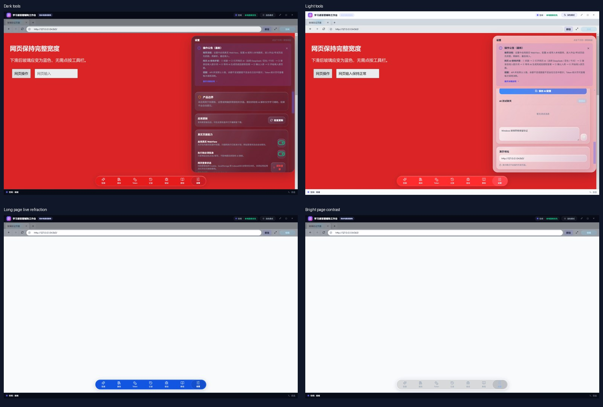

# Windows v1.5.0 验证记录

## 实现范围

七工具悬浮栏与覆盖式玻璃面板，实时网页取样、点按滑动、长按抬起拖动、单按钮镜片约束、渐隐颗粒切换、保留编辑草稿、深浅主题和窗口缩放。本次不增加后台状态岛。

取样来自当前标签的独立网页表面，坐标使用可见视口，不混入文档滚动偏移或工具栏自身。主进程验证调用来源与网页所属关系，限制区域和输出尺寸；异步结果在标签或尺寸变化后丢弃。窗口最小化后停止取样。

## 验证结果

- `npm test`：25 个测试文件，421 项通过。
- `npm run release:win`：前端、Electron、NSIS 安装包构建通过，包内预加载桥验证通过。
- `tests/installer-migration.Tests.ps1`：12 项迁移用例及参数守卫通过，沿用既有登录与数据备份恢复逻辑。
- 最终 `win-unpacked` 程序运行 `scripts/check-desktop-glass.mjs`：16 项通过，无渲染进程错误，使用独立临时用户目录。
- 逐字节核验 `app.asar` 内 32 个前端与 Electron 构建文件，全部匹配本地最终构建。应用运行版本为 `1.5.0`。

真实窗口断言包括：面板不改变网页尺寸、取样仅接受所属网页、网页键盘输入、长页面滚动后自动刷新、明亮网页切换深色标签、外部关闭吞掉整个手势、点按经过多个镜片中间位置、长按镜片抬起及栏外松手、全部七页、草稿保留、960×640 / 700×540 / 1400×900 窗口、GPU 丢失回退与恢复、最小化停止及恢复、减少动态效果。

长页面先红后蓝的实际 GPU 像素由 `[230,27,28,255]` 更新为 `[17,85,225,255]`，不需要再次点按。点按后的镜片宽度为 86px，按钮宽度为 90px。动画速度取决于设备、缩放和图形负载，不声明所有硬件固定帧率。

原始断言见 [results.json](results.json)，实际窗口截图见下图。

## 使用边界

覆盖 Windows x64 的本地实际运行环境和上述窗口尺寸，不代表所有显卡驱动均已实测。不可用或丢失的图形上下文会使用基础玻璃材质。请使用原 Windows 账号关闭应用后覆盖安装。

Windows 安装包与 Android APK 分目录保存；本次没有修改安卓原生代码或重新发布 APK。
