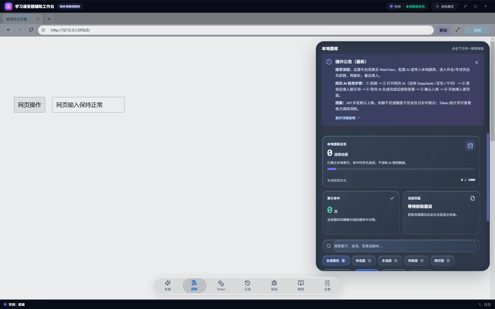

# Windows v1.5.1 验证记录

## 修复范围

暗色模式下，工具展开页使用稳定的深色底层，叠加低透明度的实时网页模糊图像，避免白色网页和原网页文字直接穿透。统一提亮标题、说明、提示、占位文字、筛选按钮及状态色，并调整主操作按钮和正确答案标记的前景色。

## 验证结果

- 单元测试：25 个文件、421 项通过。默认高并发运行曾有一项模块导入超过 5 秒；限制两个 worker 后全套通过。
- 前端、Electron 与 NSIS 构建完成，预加载桥校验通过；最终 `app.asar` 内 32 个前端与 Electron 文件与本地构建逐字节一致，版本为 `1.5.1`。
- 最终打包程序的真实窗口回归：17 项通过，无渲染进程错误，使用独立临时用户目录，不读取既有登录数据。
- 六类文字在白色网页背景上的实际像素对比度均高于普通文字的 4.5:1 要求，最低为 5.91:1。

| 检查对象 | 最低对比度 |
| --- | ---: |
| 面板标题 | 11.13:1 |
| 卡片标签 | 7.71:1 |
| 说明正文 | 7.80:1 |
| 提示文字 | 6.24:1 |
| 输入占位文字 | 7.85:1 |
| 未选中筛选按钮 | 5.91:1 |

对比度依据实际窗口截图计算：临时隐藏被测文字和过渡动画，采集对应背景区域，再使用计算后的文字颜色计算相对亮度。覆盖上述六类文字，未宣称整个应用完成无障碍认证。

其余回归覆盖七工具页、保留编辑草稿、网页输入、面板外点击拦截、长页面实时取样、点按滑动、长按拖动、三种窗口尺寸、GPU 丢失与恢复、最小化停止取样及减少动态效果。窗口缩放测试等待原生退出最大化完成；长按测试等待实际镜片抬升，避免固定等待时长导致误报。

原始断言见 [results.json](results.json)。实际暗色窗口截图如下。

本次仅更新 Windows。安装时请关闭应用，使用原 Windows 账号覆盖安装。
