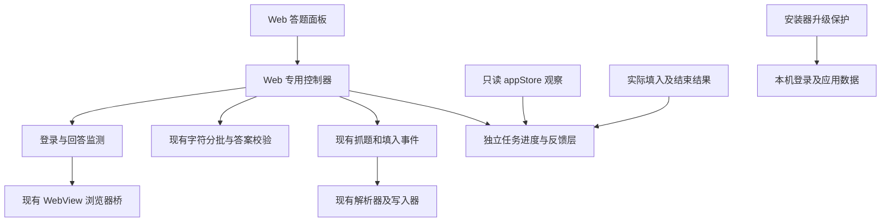

# Web 自动答题、任务反馈与升级登录保留实施计划

> **For agentic workers:** REQUIRED SUB-SKILL: Use superpowers:executing-plans to implement this plan task-by-task after explicit user approval. Steps use checkbox syntax for tracking. Follow the current session's delegation restrictions.

**Goal:** 为当前页面新增完整 Web 自动答题流程、自动检测登录和回答完成、声音与动画反馈、真实答题进度，以及保留登录的安装升级流程。

**Architecture:** Web 专用控制器持有任务和原页面身份，React 面板订阅状态；浏览器继续复用现有事件桥和严格答案协议。反馈层独立订阅任务与实际结果，安装迁移单独处理；不改 API 请求、题库、抓题解析器、答案写入器等既有业务实现。

**Tech Stack:** Electron 31.7.7、React 18、TypeScript 5.5、Vite 5、Vitest 4、现有 CSS 主题变量、lucide-react、canvas-confetti、NSIS / electron-builder 24.13.3、Windows PowerShell 5.1。

**状态：用户已确认开始，代码已实现，自动化验收通过，实机验收待完成。** 本轮未修改版本、提交或发布；完整构建和浏览器实测受执行环境限制。实施证据见 `docs/analysis/2026-10-15-web-automation-verification.md`。

实施进展：

- [x] 固定基线、修改白名单与保护文件哈希。
- [x] Web 控制器、侧栏生命周期解耦、登录与回答监测。
- [x] 当前页全部题目自动分批、严格校验、入库与填回，以及手动流程回归测试。
- [x] 实际答题进度、音效、流星、像素猫及庆祝反馈代码。
- [x] 升级迁移、恢复入口、临时数据测试及 NSIS 宏编译。
- [x] Web、反馈、安装规格复审与最终代码质量审查通过。
- [ ] 三站真实登录/流式输出 DOM 样本、Electron 深浅色及窄窗口截图。
- [ ] 完整 Vite / preload 打包和真实 v1.4.2 安装升级验收。

第 8 节保留原始验收步骤；未实际完成的实站与安装测试不得据此视为通过。

**分析基线：** 2026-10-15，`bda4f1a release: v1.4.2`，分析开始时 Git 工作区干净。执行时重新记录工作区，不能覆盖后来出现的用户改动。

## 1. 已确认范围与实施口径

1. 用户先审阅本计划并明确同意，然后开始实施；此前的其他功能修改或发布授权不代替本轮确认。
2. Web 新增“一键自动答题”：自动抓取当前题目页、生成提示词、打开所选 Web AI、等待用户登录、自动发送、等待回答结束、提取并校验、入库并填回原页面，依次处理下一批。
3. 用户已明确选择：**处理当前页面能抓取的全部题目，自动分批并填回，不提交。** 不新增 Web 翻页、自动下一题、自动交卷，也不改现有 API 逐题流程。
4. 自动化支持应用内真实 WebView 的 DeepSeek、豆包、千问。系统默认浏览器继续保留现有复制、粘贴方式；当前没有跨进程读取外部浏览器的能力，自动入口在外部模式下禁用并说明需切换应用内浏览器。
5. 继续采用完整提示词不超过 **300000 字符**、不限题数、整题分批；单题连必要模板仍超限，只跳过本次发送，保留原题和已有答案。完全复用 `prepareWebBatch`，不修改其算法。
6. 保留手动分步操作。手动点击“发送”后也自动等待并提取答案，仍由用户决定入库和填入；点击新的“一键自动答题”则授权本次任务对校验合格答案自动入库和填回，无需每批再点确认。
7. 自动填入沿用 `parseWebAnswer(...).automatic` 的完整条件：所有题目齐全、ID 与选项一致、置信度至少 0.75、无 warnings。缺题、重复、错误 requestId、低置信度等情况转为“待核对”，保留内容并提示，不继续自动填入。
8. “提取成功”指本批完整有效答案已获得；触发短提示音和哭泣像素猫。“全部完成”按任务模式判断，不能用全局 `status === 'done'` 直接触发庆祝。

## 2. 已确认的问题和依据

| 现状 | 源码依据 | 对本次设计的影响 |
| --- | --- | --- |
| 发送成功后直接结束，没有持续检测输出 | `src/webAI/WebAIWorkflow.tsx` 的 `send`，约 250 行；`sendPrompt.ts` 只确认发送 | 在发送确认后增加等待回答阶段，不能把“点击成功”当“回答完成” |
| Web 运行状态与取消令牌属于面板组件 | `WebAIWorkflow.tsx` 的 state / runRef / 卸载清理，约 65、123 行 | 从视图移到 Web 专用控制器，侧栏卸载不终止任务 |
| 收起侧栏和切换功能都会卸载答题组件 | `src/App.tsx` 约 266 行条件渲染和 `key={activeTab}`；AIPanel 的 Web 条件分支 | 保留既有导航行为，只解耦 Web 任务生命周期 |
| 浏览器本体和事件桥始终在左侧 | `BrowserPanel.tsx` 的 `useBrowserBridge`，约 447 行 | 可以复用现有标签管理，不需要重建浏览器或全局保活所有面板 |
| inspect 已有 busy 和最后一段回答，但不区分登录、消息身份 | `browserBridge.ts` 的 `webPageAction` | 增加只读页面状态，区分登录、当前回答和生成结束证据 |
| 进度在抓题时启动，并混合解析/填入权重 | `BrowserPanel.tsx` 约 492–538、748、1409 行 | 改为任务目标下的实际完成数，抓题不启动答题百分比 |
| 部分流程单题写入后也设置 done；API 失败会增加 resolvedCount | `BrowserPanel.tsx` 约 675、970 行；AIPanel 的并发循环 | 反馈不能依赖 done、resolvedCount 或状态文字推断全题成功 |
| WebView 已使用持久化登录分区，退出也有落盘逻辑 | `electron/main.ts` 的 `persist:studypilot-sites`、`flushWebviewStorage`、`before-quit` | 优先修复安装器，不调整现有 Cookie 及会话实现 |
| 自定义卸载无条件删除六个本地目录 | `build/installer.nsh` 的 `customUnInstall` | 升级也会删数据，必须区分升级与主动卸载 |
| 新安装器先运行旧卸载器，之后才执行 customInstall | 已安装依赖中的 `installSection.nsh`、`include/installUtil.nsh` | 从 v1.4.2 首次升级必须先备份；仅修改新卸载逻辑不够 |

上述行号只用于定位，实施以符号和开始实施时源码为准。

## 3. 方案选择与依赖关系

| 方案 | 优点 | 代价 | 结论 |
| --- | --- | --- | --- |
| 保持整个 AIPanel 隐藏挂载 | 生命周期改动较少 | 改变 API 面板及侧栏生命周期；Web 与展示仍耦合 | 不采用 |
| Web 专用控制器 + 订阅视图 | 收起侧栏、切换功能后仍可运行；只影响 Web 模块；易测取消和分批 | 需要将 Web 状态和操作移出视图 | **采用** |
| 主进程完整托管答题 | 可扩展系统后台任务 | 需新增较多 IPC、改变浏览器调用边界，超出本次范围 | 不采用 |



## 4. 修改白名单与保护边界

以下为实施时允许修改的完整范围。共享文件只允许表中指定片段，不能整文件重排或顺手重构。

| 现有文件 | 允许修改的片段 | 明确保留 |
| --- | --- | --- |
| `src/webAI/WebAIWorkflow.tsx` | Web 状态/操作迁出、订阅控制器、自动入口及任务控制 UI、恢复显示 | 现有手动流程行为、预览字段、复制粘贴和草稿兼容 |
| `src/webAI/browserBridge.ts` | `WebPageState` 增加只读监测字段；`webPageAction('inspect')` 增加站点登录、回答身份及结束信号 | 既有 host 限制、prepare/send 输入和发送行为 |
| `src/webAI/sendPrompt.ts` | 将要求人工提取的两处提示语调整为自动检测/人工兜底文案 | 发送确认条件、120 秒发送阶段上限、只尝试一次和取消语义 |
| `src/webAI/web-ai.css` | 自动/手动模式、任务状态、开始/暂停/继续/停止/声音控件的局部样式 | 全局按钮及其他功能样式 |
| `src/components/BrowserPanel.tsx` | 替换专用进度计算和展示；移除抓题启动进度的语句；在既有成功/跳过/结束回调旁增加只读结果上报；挂载独立反馈层 | 导航、标签、WebView 分区、抓题、串行写入、重试、超时、下一题和原有回调业务 |
| `build/installer.nsh` | 升级清理保护、旧版升级前备份/安装后恢复钩子、迁移错误处理 | 安装位置、注册表身份及普通主动卸载的既有语义 |
| `package.json` | 默认不改；仅在打包验证证明需要时调整本需求必需的 NSIS include 配置，并先说明原因 | version、name、appId、productName、依赖、scripts、其他构建配置 |

计划新增：

| 新文件 | 单一职责 |
| --- | --- |
| `src/webAI/WebAIController.ts` | Web 状态快照、任务互斥、手动动作保持、一键分批流程、取消/暂停、UI 恢复 |
| `src/webAI/pageMonitor.ts` | 注入时钟和 inspect 的登录等待、输出结束检测、长等待提醒及轮询调度 |
| `src/answerActivity/activityStore.ts` | 任务目标、实际成功集合、终态与反馈事件去重；不持久化答案正文 |
| `src/answerActivity/AnswerActivityLayer.tsx` | 常驻宿主、只读 API 状态观察、进度/流星雨/像素猫/庆祝显示、声音开关 |
| `src/answerActivity/feedbackAudio.ts` | 用户手势解锁 AudioContext、两种短音、静音及失败降级 |
| `src/answerActivity/answer-activity.css` | 仅本次反馈层的深浅色、动画、布局及 reduced-motion 样式 |
| `src/answerActivity/assets/crying-pixel-cat.png` | 本地像素猫精灵图，随包离线加载，不引入远程图片 |
| `build/session-migration.ps1` | 固定应用目录的备份、校验与恢复；兼容 Windows PowerShell 5.1 |
| `tests/web-ai-monitor.test.ts` | 流式结束、登录、长等待及取消测试 |
| `tests/web-ai-controller.test.ts` | 完整链路、分批、停止、恢复、严格校验与侧栏生命周期测试 |
| `tests/answer-activity.test.ts` | 实际进度、终态、部分失败、去重及旧答案隔离测试 |
| `tests/installer-migration.Tests.ps1` | 临时目录内备份/恢复/失败路径的独立自测脚本 |
| `docs/analysis/2026-10-15-web-automation-verification.md` | 实施阶段的差异边界和验收记录 |

**默认保护、不得修改：** `src/App.tsx`、`src/components/AIPanel.tsx` 全部 API/手动答题代码、`src/store/appStore.ts`、`src/webAI/protocol.ts`、`src/webAI/useBrowserBridge.ts`、`src/utils/aiRequest.ts`、`electron/main.ts`、`electron/preload.ts`、`electron/preload-webview.ts`、`electron/preload-webview/**`、其他所有面板、`src/index.css`、现有测试、lockfile、发布脚本和历史文档。

遇到白名单外的真实阻塞，先报告证据和需要追加的最小范围，获得同意后处理。不能为修无关失败、升级依赖、全局格式化、重构而扩大范围。

## 5. Web 全自动流程设计

### 5.1 用户操作与状态

在现有 Web 答题页增加“手动步骤 / 自动答题”分段选择。自动模式保留现有 AI 服务商选择，主按钮为 Play 图标加“开始自动答题”。点击时完成本次自动入库及填回授权，并解锁提示音。

```text
idle
  -> extracting        固定原题标签与 URL，抓取当前页全部题目
  -> preparing         保存题目快照，生成第 1 批
  -> opening           打开/复用所选 AI 标签
  -> waiting_login     提醒用户登录，持续检查
  -> sending           准备输入并沿用发送确认
  -> waiting_answer    持续扫描，等待输出结束
  -> validating        校验 requestId、完整题目及答案质量
  -> importing         合格答案调用现有入库方法
  -> checking_source   切回原标签并重新抓题，核对原题快照
  -> applying          逐题通过既有写入队列填回，等待实际结果
  -> preparing         有剩余题目时生成下一批并循环
  -> completed         原始目标集合全部获得合格答案且全部填入成功

独立分支：paused、needs_review、partial、failed、stopped。
waiting_login / waiting_answer 内可保留 warning 标记，不因首次长等待直接结束。
```

监测辅助接口的约定：

```ts
type AuthState = 'ready' | 'required' | 'unknown';
type GenerationState = 'running' | 'finished' | 'unknown';
type MonitorSnapshot = {
  authState: AuthState;
  generationState: GenerationState;
  messageKey: string; // 当前助手消息的稳定标识/位置，不是整个会话正文
  text: string;
  ready: boolean;
  busy: boolean;
};

type WebRunPhase = 'idle' | 'extracting' | 'preparing' | 'opening'
  | 'waiting_login' | 'sending' | 'waiting_answer' | 'validating'
  | 'importing' | 'checking_source' | 'applying' | 'paused'
  | 'needs_review' | 'partial' | 'completed' | 'failed' | 'stopped';
```

控制器保存稳定引用的不可变快照，通过 `useSyncExternalStore` 订阅，遵循现有 GlobalStore 模式。每次运行生成 `runId`，每批仍使用现有 `requestId`，所有异步返回在写入状态或发出下一操作前校验两者。

### 5.2 抓题、分批和填回

- 原题来源是用户点击开始时的活动题目标签；后续所有抓题/核对/填回都显式带该 `targetTabId` 与 `expectedUrl`，不以之后活动标签代替。
- 本次目标为首次抓到的全部题目；固定题目快照和目标 hash 集合，后台重新抓题不能改变分母。
- 循环直接使用 `prepareWebBatch(remaining, provider)`。不得恢复 50 题上限、截断单题、修改提示词格式或自行合并重排题目。
- `skipped` 单独记录，后续可处理题目继续执行；任何跳过均不能显示“原始全部题目完成”，最终显示部分完成和跳过数量。
- 每批重新确认登录、聊天页就绪和发送确认。复用同一 AI 标签，保存当前消息基线与 requestId，避免误读上一批。
- 仅当本批 `preview.automatic === true` 才自动入库和填入。保留原协议的题目/选项校验和 confidence/warnings 规则。
- 填入前重新抓取原标签，调用 `sameQuestions` 校验本批原题及选项；已登录不代表原题没有变化。
- 每题写入等待现有 `studypilot:apply-answers` 回调；`success: true` 且未 `skipped`/`partial` 才记为完成。
- 默认每批核对一次原题，逐题写入沿用现有 URL 检查和取消检查；停止后不再排下一题或下一批，已开始的页面动作无法撤回。
- 自动模式暂停发生在原子步骤之间；正在发送/写入的单次动作先返回，再停在边界。继续时重检页面和 runId，不能重复发送或重复计数。
- 校验失败进入 `needs_review`，保留预览，停止后续批次；用户可切回现有手动流程核对处理，自动流程不会自行放宽校验。

### 5.3 未登录等待

- 开站先等待 WebView DOM 就绪，页面载入期间允许短暂 inspect 失败，使用 2 秒间隔串行检查。
- 各站点适配器结合登录入口/登录弹层、聊天输入状态和正向会话信号，输出 `required / ready / unknown`。不能仅以 textarea 存在判定登录成功。
- 未登录或遇验证码时，显示“请在网页完成登录/验证，完成后自动继续”，首次进入时发送一次现有桌面通知。
- 连续两次确认可用且无登录阻挡后继续；DOM 刷新、账号切换、重新导航期间不能误判。
- 等待 5 分钟仍未就绪，再提醒一次，之后至少间隔 10 分钟提醒；不反复弹窗或播放成功音。用户未停止时持续检测。
- 站点支持免登录聊天且输入区实际可发送时，以该站点适配器明确确认的可用状态继续；不能因游客输入框存在就推定成功。
- 不操作登录凭据、不自动点击验证码、不扩大站点 host 允许列表。未知状态保持等待并提示查看网页。

### 5.4 输出结束与自动提取

- 每次 inspect 完成后再等待 1.5 秒进行下一次检查，不使用会产生并发请求的固定 setInterval；DOM 本身仍由目标网站维护。
- 发送继续使用现有 `sendWebPrompt`；它成功只代表网站已接收，不代表答案完成。未确认发送时不重复发送。
- 自动提取同时要求：属于当前请求的助手消息、回答有完整 JSON、requestId 正确、生成状态已结束、正文稳定至少 3 秒且连续三次一致。
- 若站点没有可靠的结束标志，要求完整答案协议、非 busy、同一助手消息稳定至少 6 秒；不能仅凭“停止按钮消失”判定成功。
- 正文变化或 busy 恢复立即重置稳定计时。旧 requestId、用户提示词回显、代码块半截、思考过程、空回答不触发成功。
- 输出结束但答案不齐或校验失败，提取到预览并提示待核对，不响成功音、不显示猫、不自动填入。
- 5 分钟仍没有完整答案时提示“长时间未获取完整答案，请查看 AI 网页”；继续扫描，提醒频率同登录等待。正文持续变化时显示“仍在生成”，不误报已失败。
- 临时 inspect 错误采用 2 / 4 / 8 秒退避；标签关闭、跳至非允许站点、连续三次无法访问则结束自动链并提示重新打开。恢复不自动重发不确定的请求。
- 重新登录后恢复当前请求的检测；找不到对应回复则留在等待/人工核对，不能把已有其他消息填到原题。

### 5.5 生命周期和互斥

- 常驻反馈层挂在已常驻的 BrowserPanel 内，由其接入控制器运行宿主；AIPanel 和 App 既有条件挂载完全保留。
- 面板卸载仅取消 UI 订阅；`runId`、浏览器标签、批次、计时器和队列属于控制器，不因侧栏收起/功能切换重置。
- 重新展开从快照恢复当前阶段、原来源、剩余批次和预览，不重新抓题、不重新发送。
- 使用现有 batchRunning 互斥标志，取得所有权后设置，结束时只释放自己持有的标志；等待登录/输出期间也不能启动另一组 API/Web 自动任务。
- `stop` 令牌立即失效并取消轮询等待；每个 await 后检查令牌，迟到回调不得触发猫、音效、入库或下一步。
- 应用退出、页面整体刷新、WebView 崩溃或用户关闭相关标签属于中断，不承诺重启后自动续发；草稿按现有方式保留。
- React StrictMode 双挂载不得产生第二个控制器或第二条扫描循环。只在实际宿主销毁时终止运行，视图卸载不终止。

## 6. 动效、音效及进度口径

### 6.1 事件与反馈

| 事件 | 判定 | 反馈 | 去重 |
| --- | --- | --- | --- |
| 本批提取成功 | 输出结束、本批所有答案校验通过 | 约 250ms 轻提示音；哭泣像素猫出现约 2.5 秒 | `runId + requestId + extracted` |
| 全部题目完成 | 对应模式所有目标成功且任务进入真实成功终态 | 短庆祝音；页面显示 🎉，复用 canvas-confetti 约 2 秒 | `runId + completed` |
| 正在自动答题 | 发送、等待生成、校验、入库、核对及填入 | 低密度流星雨持续运动 | 单个常驻实例 |
| 等待登录/暂停/待核对 | 用户操作阻塞或明确暂停 | 状态提示，流星暂停 | 不触发成功反馈 |
| 部分完成/停止/失败 | 存在缺题、跳过、错误或主动停止 | 显示真实数量和原因 | 不触发全部完成庆祝 |

最后一批提取成功和全题填入成功发生很近时，先显示猫，再显示庆祝；声音串行播放，不叠音。历史草稿恢复、重复扫描、重新展开、主题切换不重播。

音频用本地 Web Audio 短音合成，无新增音频依赖。开始任务的用户手势解锁 AudioContext；自动播放受限或设备不可用时仍完成任务，并在状态中提示音效未启用。专用音量图标按钮提供静音和 tooltip，偏好用独立 localStorage key 保存，不修改现有设置模块。

API 入口不增加音频调用：常驻反馈层在主应用首次 pointerdown/keydown 手势中尝试解锁声音，监听只用于音频，不阻止事件传播；宿主销毁时清理。若任务没有可用用户手势，则保留视觉反馈，不能把响铃失败当成答题失败。

### 6.2 答题进度

- 抓题、生成提示词、打开网站、等待登录仅显示阶段状态，不计入答题百分比，也不因抓题完成而显示 100%。
- **Web 一键模式及 API 边搜边填：** `已成功填入的目标题目数 / 本次目标题目数`。解析仅作辅助计数，不能按 0.72 等权重混入主进度。
- **API 仅查询/解析：** `已有有效答案的目标题目数 / 本次查询目标题目数`，标注“答案生成”；不能标为“已填入”。
- **Web 手动发送监测：** 只展示当前请求等待状态和提取结果，不把未获填入授权的答案计为“自动填入完成”。
- 固定当前任务的目标集合，复用旧答案可在实际写入成功后计入；过往已填 hash、其他页面的 answerMap 或上个任务的计数不得直接累计。
- 对既有 API 逐题考试，总题数无法从现有数据确定时显示“已完成 N 题”和不定长流动轨道；不以当前只抓到 1 题显示全卷 100%。只有收到既有下一题结果的结束证据后才判断终态。
- API 状态由独立观察器只读订阅 appStore；实际填入结果从 BrowserPanel 既有回调旁上报。无需改动 AIPanel 的请求、重试、并发、暂停或考试循环。
- 部分流程中间会设置 `done`，因此已填入数量齐全、运行标志结束、实际终态三者共同判断。逐题离开答题页、题目不变化、安全上限触发不能作为“全部完成”。

音乐进度条采用细轨道、实际完成段、明亮播放头和已用时间。完成段收到真实结果后用 350–600ms 平滑前移；等待时轨道内部保持轻流动，播放头不虚增百分比。暂停时冻结，错误/停止时停止运动，只有真实全成功才到 100%。

### 6.3 视觉与性能

- 沿用现有 `--bg-panel`、`--primary-color`、`--accent-color`、文本及边框变量，不改变整体深浅色主题、卡片或按钮风格。
- 猫使用本地低分辨率精灵图和 `image-rendering: pixelated`，固定约 64–80px 展示空间；不推动页面布局。
- 流星限定答题工作区、低透明度、约 10–14 条，优先 CSS transform/opacity；不闪烁、不持续重新随机布局、不覆盖表单交互。
- 反馈层不向第三方题目/AI 页注入装饰。覆盖层默认 `pointer-events: none`，仅控制按钮可交互；避免遮挡原页面选项、地址栏和停止入口。
- `prefers-reduced-motion` 时禁用流星及粒子飞散，猫和 🎉 静态短显，真实计数仍更新。
- 窗口不可见时可暂停纯装饰动画，任务检测不能依赖动画帧；恢复窗口不重新发送请求。侧栏收起在前台时必须保持原检测频率。
- 在 Electron 实机检查 DOM 覆盖 WebView 的层级、浏览器全屏和已有 jelly 效果，不能只凭浏览器预览判定效果正常。

## 7. 安装升级保留登录

### 7.1 后续版本正常升级

- 保持 `name=study-pilot`、`appId=com.studypilot.desktop`、productName、userData 路径和 `persist:studypilot-sites` 不变。
- 自定义卸载逻辑先检查 electron-builder 的 `${isUpdated}` 及保留数据标记；升级/保留数据时不执行删除用户目录。
- 不把 `deleteAppDataOnUninstall` 单独改为 false 作为全部修复：本地模板默认清理已经排除升级，真正问题是自定义清理没有判断。
- 普通用户主动卸载且明确执行原有清理语义时，保留既有清理行为；现有 App 内“清除登录”功能保持原样。

### 7.2 从现有 v1.4.2 第一次升级

旧版本卸载器的删除逻辑已经固化到旧 exe，无法靠新版本的保护条件修复。因此首次迁移采用以下时序：

```text
新安装器运行进程检查
  -> 等待应用进程完全退出，确保现有退出落盘流程结束
  -> 备份并校验固定应用数据目录
  -> 验证备份成功后才允许运行旧卸载器
  -> 安装新程序
  -> 恢复原路径并校验
  -> 允许启动新程序
```

- 使用依赖真实提供的 `customCheckAppRunning` 包装默认 `_CHECK_APP_RUNNING`，安装端进程检查后执行备份；`customInstall` 执行恢复。卸载端只运行默认进程检查，不运行迁移备份。
- 定义 customCheckAppRunning 后，上游会跳过默认的 `getProcessInfo.nsh` / `pid` 声明；自定义 include 必须显式提供这些声明并避免重复，保证复用默认检查可编译。
- 不修改 `node_modules` 模板、不引入自定义安装器主体、不改变已有安装身份和默认卸载流程。
- 备份位置固定为当前用户本地目录下独立的 `StudyPilotUpgradeBackup/<迁移ID>`，不能位于 `$INSTDIR` 或旧卸载器会删除的六个目录下。
- 备份覆盖旧脚本中六个明确目标目录内已有的应用数据，包含完整 Electron profile、Local State、Cookies、Local Storage、IndexedDB、Partitions 和应用数据库，保持相对路径及加密上下文，不能只复制 Cookie 数据库。
- 迁移脚本只接受内置应用根目录映射和安全迁移ID，验证规范绝对路径；拒绝越界、符号链接/重解析点跳转，不复制其他用户或整个 APPDATA。
- 备份完成后核验关键目录、文件清单和 SHA-256，任何读取/权限/磁盘错误在旧卸载之前终止安装；不允许“备份失败但继续卸载”。
- 恢复在应用启动之前进行；中断、恢复失败时保留备份和不含凭据的诊断信息，阻止自动首启，提供原路径恢复入口。不能在恢复校验前删除备份。
- 在备份目录保存经过校验的 helper 副本、manifest 和恢复命令说明，避免安装失败后 `$PLUGINSDIR` 清理导致恢复工具丢失；恢复只接受匹配本机固定根目录映射的 manifest，不接受任意目标路径。
- helper 按 PowerShell 5.1 测试，不依赖用户安装 Node、PowerShell 7 或全局第三方模块；manifest 使用固定字段数组，避免将 package-lock 等不适合 PS5.1 的 JSON 当对象改写。
- 安装异常处理保留迁移ID和原目录映射；只删除已验证的本次临时文件，不增加无边界递归清理。
- 验证同 Windows 用户下覆盖安装、改安装目录、重新安装和升级第二次；不同用户/设备的加密登录数据迁移不属于本次目标。

**验收边界：** 防止本地安装升级清除仍有效的登录数据；网站自身使 Cookie 过期、撤销登录或要求二次验证时，不能保证免登录，应用应正常提示登录。

## 8. 实施任务与验证步骤

### Task 1：固定保护基线

- [x] 记录开始实施时 Git HEAD、status、已有 diff；建立 57 个既有文件 SHA-256 清单，白名单共享文件保留原文对比。
- [x] 运行 `npm test`、`npm run build`、`npm run electron:build`，记录基线 `spawn EPERM`；采用外部等价配置完成 Vitest，不调整无关代码。
- [x] 确认当前登录数据实际路径和基线 v1.4.2 卸载逻辑；只记录路径及存在性，不读取/输出 Cookie 或 API Key。
- [x] 将本计划中的文件白名单和用户已确认范围写入实施验收记录。

### Task 2：Web 任务移出面板

- [ ] 新建 WebAIController，保存现有 Web 草稿、站点、来源、批次、预览及操作状态；迁移手动动作时保留语义。
- [ ] 先写控制器测试：同一运行只获得一次互斥锁、视图订阅卸载不停止、重订阅恢复原请求、旧 runId 回调被丢弃、停止正确释放自己的锁。
- [ ] WebAIWorkflow 改为快照订阅与命令调用；BrowserPanel 内增加唯一常驻宿主，App/AIPanel 无改动。
- [ ] 验证现有手动抓题、生成、打开、发送、复制、提取、预览、入库、核对填回和草稿恢复均正常。

控制器的执行约束：

```text
startAutomatic:
  检查 internal / 真实WebView / 无其他任务
  先登记自己的所有权，再设置现有 batchRunning
  固定 runId、source、目标题目快照
  按第5节状态机循环，所有 await 后检查 runId
finally:
  仅当前 runId 的拥有者释放自己的标志和定时器

unsubscribeView:
  只移除订阅，不取消任务
stop:
  使 runId 失效、取消等待、保留已产生的数据和草稿
```

### Task 3：登录和输出监测

- [ ] 为三个现有站点记录匿名、已登录、生成中、生成结束的 DOM 样本，再完善 inspect 只读字段；不修改发送按钮选择与输入实现。
- [ ] 写 pageMonitor 的注入时钟测试，覆盖第 9 节 M01–M08；先确认旧实现不具备对应行为，再实现监测。
- [ ] 采用串行轮询、稳定窗口、请求匹配和提醒限频；纳入停止令牌与暂时页面错误退避。
- [ ] 手动发送确认后自动启动监测并更新预览，保留手动提取作为兜底；调整 sendPrompt 的人工提取文案。
- [ ] 执行 `npm test -- tests/web-ai-monitor.test.ts tests/web-ai-send.test.ts tests/web-ai.test.ts`，预期新旧测试全部通过。

### Task 4：接通完整自动分批链路

- [ ] 写注入浏览器命令与页面事件的链路测试，覆盖一次开始依次执行抓题、分批、打开、等待登录、发送、等待输出、校验、入库、核对、填回。
- [ ] 实现自动入口和状态机，复用现有协议、严格自动资格及页面事件。
- [ ] 多批使用实际 remaining 循环，分批之间不等待人工点击；累计成功/失败/跳过记录按原始题目 hash 去重。
- [ ] 加入暂停/继续/停止和待核对分支，连续点击开始不产生重复请求。
- [ ] 验证停止、登录过期、来源跳转、页面关闭和不确定发送均不会造成重复发送或串题。
- [ ] 执行 `npm test -- tests/web-ai-controller.test.ts tests/web-ai.test.ts tests/web-ai-send.test.ts tests/web-ai-protocol.test.ts`，预期全部通过。

### Task 5：真实任务进度与视听反馈

- [ ] 在 activityStore 先测试目标集合、成功数、跳过、终态和事件去重，API 观察器仅读取既有状态，不写回 API 状态。
- [ ] BrowserPanel 在既有成功和终态回调旁上报观测事件；保留原返回结果、串行队列和全部现有业务分支。
- [ ] 移除专用进度中抓题启动、0.72 混合权重和中间 done 即完结判断，接入第 6 节的实际计数。
- [ ] 新增低密度流星、音乐进度头、像素猫精灵和 🎉 庆祝，加入局部声音控件、提示音去重与降级。
- [ ] 验证最后一批提取与全题完成的反馈顺序、静音、侧栏关闭后的可见反馈和 reduced-motion。
- [ ] 执行 `npm test -- tests/answer-activity.test.ts`，预期抓题不增进度、失败不庆祝、重新展开不重播。

### Task 6：安装升级数据保护

- [ ] 在临时目录使用伪造 profile、Local State、Cookies 和数据库文件建立旧版升级删除场景，不触碰开发机真实登录数据。
- [ ] 编写迁移 helper 及独立测试：备份恢复哈希一致、中文路径、空目录、权限错误、空间不足、越界/重解析点、重复执行和中断重试。
- [ ] 更新 installer.nsh 的升级保护与备份/恢复时序，确认编译时安装/卸载分支的宏、变量和钩子均存在。
- [ ] 执行 `powershell -NoProfile -ExecutionPolicy Bypass -File tests/installer-migration.Tests.ps1`，预期所有用例通过，测试只使用自建临时目录。
- [ ] 执行 `npm run pack:win`；安装测试在独立 Windows 测试账号或虚拟机中进行，覆盖真实 v1.4.2 安装包升级及二次升级。
- [ ] 未验证从真实旧版升级可保留登录前，不宣称本需求完成，也不发布安装包。

### Task 7：回归、差异审查与交付

- [ ] 执行一次完整 `npm test`、`npm run build`、`npm run electron:build`，并检查 WebView preload 仍完整构建。
- [ ] Electron 实机执行第 9 节关键旅程，截图核对深浅色、窄工作区、展开/收起、浏览器全屏、动效与 WebView 叠层。
- [ ] 对比保护文件哈希；白名单外运行文件零变化，共享文件逐 hunk 对照本计划。
- [ ] 回归 API 题库命中、限流重试、并发、暂停、边搜边填、逐题考试、手动填入，以及题库、Token、记录、错误报告、教程和设置入口。
- [ ] 更新验收记录，列明实际通过、无法验证和残余站点适配问题；本计划不包含版本号修改、Git 提交/推送或 GitHub Release。

## 9. 必测矩阵

| 编号 | 场景与输入 | 必须结果 |
| --- | --- | --- |
| M01 | 未登录 -> 登录弹窗 -> 登录成功连续两次 | 一次登录提醒；登录后自动发送一次 |
| M02 | 游客输入框、验证码、未知 DOM | 不误判登录；等待用户操作，不循环提交 |
| M03 | busy=true 时已出现完整 JSON | 继续等待，不提取成功、不填入 |
| M04 | busy=false 但正文变化/JSON 半截 | 稳定计时重置，不提前提取 |
| M05 | 旧 requestId、提示词回显、上一批回答 | 当前成功数为 0，不入库、不填入 |
| M06 | 正确本批完整 JSON、结束状态、稳定窗口满足 | 提取一次；音效和猫各一次；自动模式继续填回 |
| M07 | 等待超过 5 分钟后才完成 | 到时提醒且继续扫描；完成后正常继续，无重复提醒风暴 |
| M08 | inspect 未返回时停止，随后迟到返回 | 无后续发送/写入/成功反馈，任务锁正确释放 |
| M09 | 137 道短题、字符总长合规 | 不按 50 题切分；全部参与当前自动任务 |
| M10 | 多批、单题超限、所有题都超限 | 可处理批次继续；超限原题保留；结果为部分完成或未处理，无庆祝 |
| M11 | 缺题、重复题ID、字母与内容矛盾、低置信度 | 预览保留，待核对，无自动写入 |
| M12 | 原题 URL/题干/选项改变，或原标签关闭 | 自动填入被阻止，答案保留，原因明确 |
| M13 | 收起侧栏、切换教程/设置、重新展开 | 同一 runId 持续；无取消、丢状态或重复提交 |
| M14 | 单题成功后 done，但整批未结束 | 真实进度前进，不庆祝，不隐藏进行中状态 |
| M15 | success=true 且 partial/skipped，或某题请求失败 | 不将失败算成功，不到 100%，不庆祝 |
| M16 | API 普通批量、边搜边填、缓存答案、逐题未知总数 | 正确模式计数；未知总数不伪造全卷百分比；原业务行为不变 |
| M17 | 同一页面重新开始、已有旧 answerMap/applied hash | 新任务不继承旧填入成功数，不重复庆祝 |
| M18 | 静音/音频阻止/主题切换/reduced-motion | 任务正常，音效正确降级，布局稳定 |
| M19 | 已登录 v1.4.2 -> 新安装包 -> 再次启动 | 同用户有效会话及题库配置保留，不要求因安装清理重新登录 |
| M20 | 二次升级、改安装目录、迁移中断/恢复失败 | 数据原路径不变；失败保留备份且阻止不完整首启 |
| M21 | 普通主动卸载、App 手动清除登录 | 保持原既有语义，不被升级恢复意外还原 |
| M22 | 站点自身让 Cookie 过期 | 正确提醒重新登录并继续检测，不声称仍已登录 |

监测测试使用可控时钟，避免真实等待 5 分钟；站点 DOM 与实际 Electron 登录、安装迁移另做实机验证，不能用单元测试代替。

## 10. 审阅结论和确认点

- 本计划覆盖原六项需求，并加入用户补充的一键完整 Web 自动链路。
- 自动处理范围已确定为当前页面；单批 300000 字符规则保持；成功填回后不提交。
- API、题库、原有题目解析和写入实现列为保护范围；共享 BrowserPanel 仅调整本次进度/反馈观测接入。
- 最需验证的两个工程点为第三方网站的登录/结束状态适配，以及真实 v1.4.2 卸载器参与的首次升级迁移。
- 实施顺序：基线 -> 控制器生命周期 -> 登录/输出监测 -> 全自动分批 -> 进度与反馈 -> 安装迁移 -> 回归和差异验收。
- **用户确认整份计划后，才开始 Task 1 及后续代码修改；本轮不实施。**
